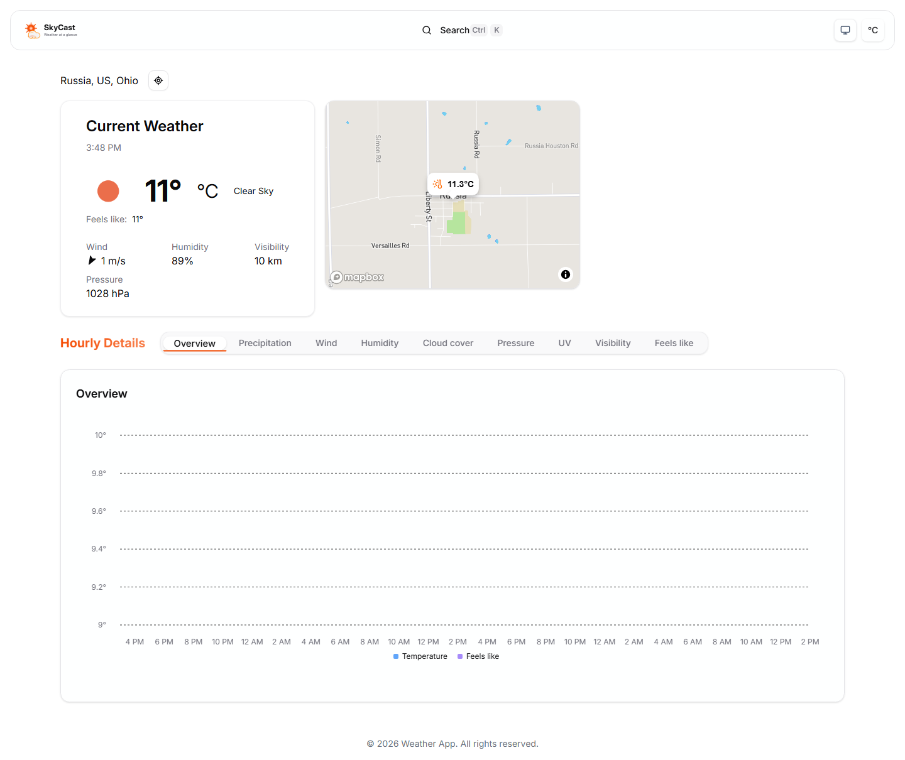

# SkyCast — Weather App

A weather dashboard built with React, TypeScript, and Vite. Explore current conditions, hourly forecasts, and an interactive map for your selected location.



## Features

- Search for a city or use your current location.
- View temperature, feels-like temperature, wind, humidity, visibility, and pressure.
- Explore hourly temperature, precipitation, wind, humidity, cloud cover, pressure, UV, visibility, and feels-like charts.
- Browse an interactive Mapbox map.
- Switch between metric and imperial units and light, dark, or system themes.
- Remember your location and unit preferences in local storage.

## Run locally

Requires Node.js 20.19+ or 22.12+ and npm.

Clone the repository and install dependencies:

```sh
git clone https://github.com/Ignatiostou/Weather_App.git
cd Weather_App
npm ci
```

Create `.env` in the same folder as `package.json`:

```dotenv
VITE_OPENWEATHER_API_KEY=your_openweather_api_key
VITE_MAPBOX_ACCESS_TOKEN=your_mapbox_public_access_token
```

The OpenWeather key needs access to the One Call API 3.0 and Geocoding API. Use a public Mapbox access token. Vite exposes `VITE_` variables to the browser; use credentials intended for client use and keep your local `.env` out of Git.

```sh
npm run dev
```

Open the local URL printed by Vite. Restart the development server after changing `.env`.

## Commands

| Command | Purpose |
| --- | --- |
| `npm run dev` | Start the development server |
| `npm run build` | Type-check and build into `dist/` |
| `npm run preview` | Serve the production build locally |
| `npm run lint` | Run ESLint |

## Project layout

The application files live at the repository root. Browse `src/` for the application code and `public/` for static assets.

| Folder | Contents |
| --- | --- |
| [src/api/](src/api/) | OpenWeather API client |
| [src/components/](src/components/) | Dashboard, charts, providers, and UI components |
| [src/config/](src/config/) | Defaults and storage keys |
| [src/hooks/](src/hooks/) | Weather context hook |
| [src/types/](src/types/) | Weather response types |
| [public/](public/) | Static assets |
| [docs/images/](docs/images/) | App screenshot |

Built with React, TypeScript, Vite, Tailwind CSS, Radix UI, Recharts, Mapbox GL JS, and Axios.
